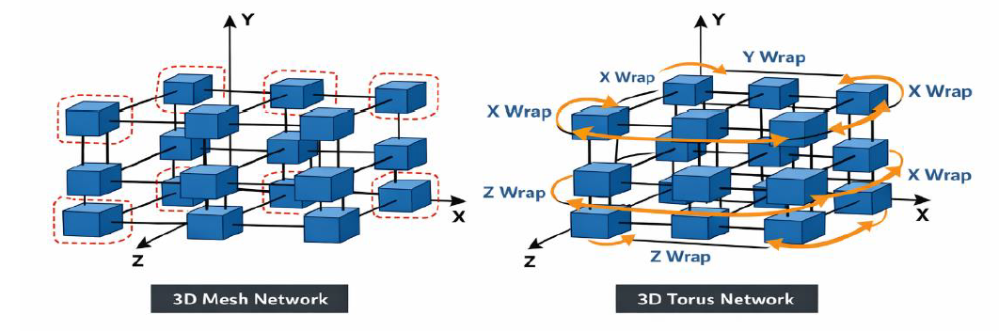
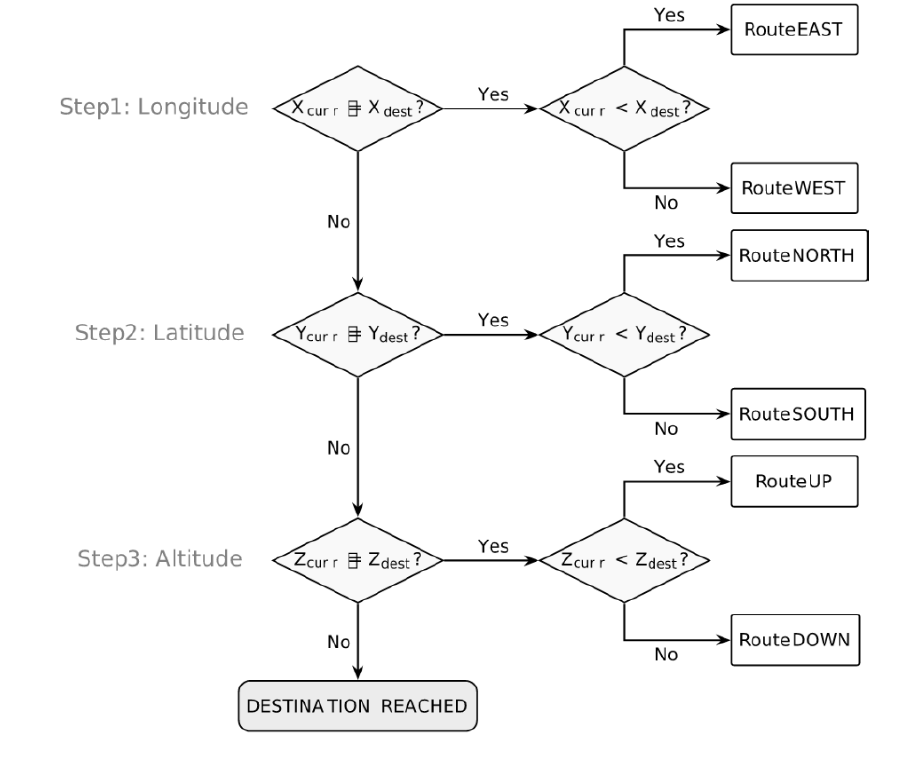
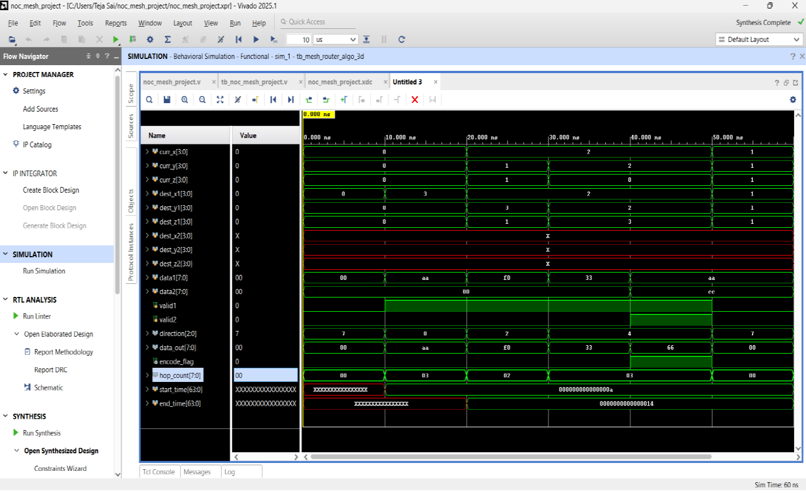
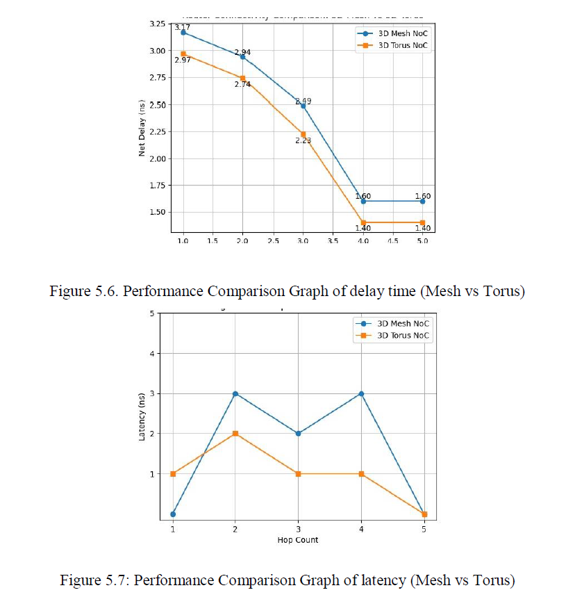
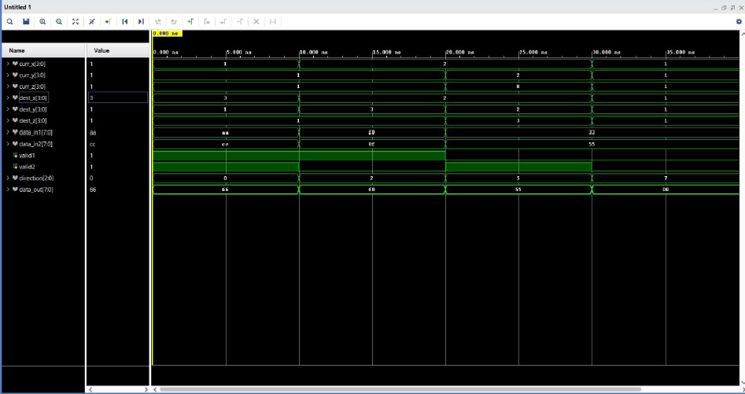
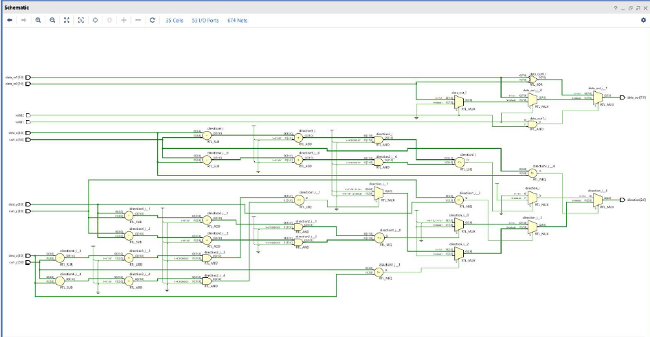
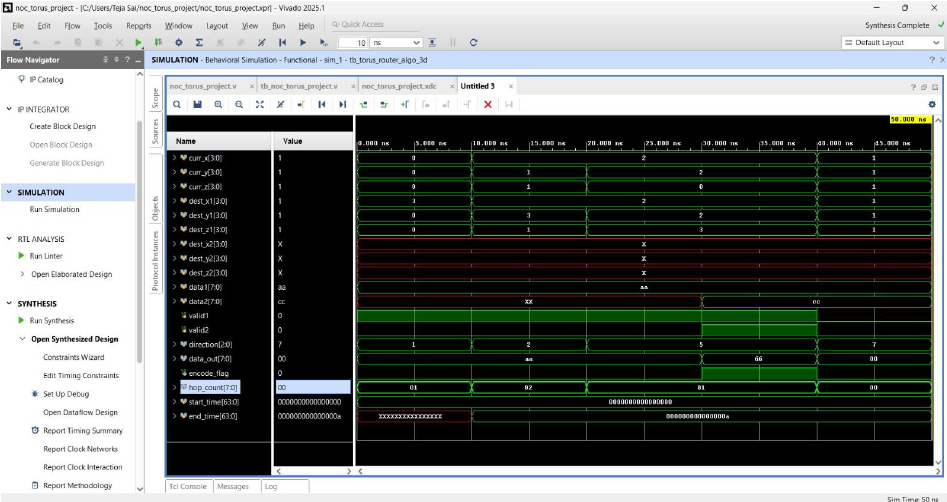

# HIGH-EFFICIENCY TEST ARCHITECTURE FOR 3D TORUS
NoC USING XOR-BASED CODING

> B.Tech Final-Year Project | Electronics and Communication Engineering  
> **Author / Repository Maintainer:** B. Raghunadh  
> **Focus:** 3D Mesh and 3D Torus topologies, dimension-based routing, XOR-based network coding, and Verilog RTL simulation.

## Overview

This project studies routing and functional-test concepts for three-dimensional Network-on-Chip (3D NoC) architectures. It compares 3D Mesh and 3D Torus topologies, examines a routing decision flow across the X, Y, and Z dimensions, and documents RTL simulation and schematic results produced using AMD/Xilinx Vivado.

The project materials describe an XOR-based network-coding approach for functional testing of NoC routers. The exact implementation details, test coverage, and measured results should be read alongside the source code, thesis, and simulation setup included by the project authors.

## Objectives

- Study the connectivity differences between 3D Mesh and 3D Torus topologies.
- Implement and simulate routing logic using Verilog HDL.
- Examine routing decisions across the X, Y, and Z dimensions.
- Explore XOR-based data coding and related functional-test signals.
- Compare the delay and latency values recorded in the project report.
- Preserve simulation waveforms and RTL schematic evidence for review.

## Technology and concepts

- Verilog HDL
- AMD/Xilinx Vivado
- RTL design and behavioral simulation
- Network-on-Chip (NoC)
- 3D Mesh and 3D Torus topology
- Dimension-based routing
- XOR-based network coding
- Functional testing

## Architecture and workflow

1. **Topology study** — compare 3D Mesh connectivity with 3D Torus wraparound links.
2. **Routing logic** — evaluate routing decisions across the X, Y, and Z coordinates.
3. **RTL implementation** — describe the design in Verilog HDL.
4. **Behavioral simulation** — inspect signal transitions and data movement in Vivado.
5. **RTL schematic review** — examine the logic structure produced by the design tools.
6. **Performance comparison** — document the delay and latency graphs reported by the project.

## Results gallery

### 3D Mesh vs. 3D Torus topology



### 3D Torus routing algorithm



### Vivado behavioral simulation



### Net delay comparison



The supplied graph shows these plotted values (in ns):

| Point shown in graph | 3D Mesh NoC | 3D Torus NoC |
|---:|---:|---:|
| 1 | 3.17 | 2.97 |
| 2 | 2.94 | 2.74 |
| 3 | 2.49 | 2.23 |
| 4 | 1.60 | 1.40 |
| 5 | 1.60 | 1.40 |

These values are transcribed from the provided figure. The experiment configuration and the meaning of each x-axis point should be documented from the thesis before interpreting them as a general performance result.

### Torus routing waveform



### RTL schematic



### Routing connectivity waveform



## Source code and simulation

The `rtl/` and `testbench/` folders contain Verilog modules transcribed from the supplied `codes.pdf`. Because PDF extraction can alter formatting or line breaks, compile and review every module in Vivado before describing the project as fully reproducible.

Once those files are added, document:
1. The Vivado version and project setup.
2. The top-level RTL module and testbench names.
3. The steps used to run behavioral simulation.
4. Expected signals and pass/fail criteria.
5. Any synthesis settings needed to reproduce the RTL schematic.

Do not treat the screenshots alone as a complete, reproducible simulation package.

## Author and license

**Author / Repository Maintainer:** B. Raghunadh. See [`LICENSE`](LICENSE) for the license covering original project code and documentation where the author has the rights to license them. Third-party research papers and supplied figures remain subject to their respective rights and licenses.

## References and source documents

See [`references/references.md`](references/references.md) for the research-paper bibliography, DOI/publisher links, and notes about included source materials. The available project thesis and abstract are stored under `references/source-materials/`. The primary IEEE paper is linked by DOI rather than copied as a PDF because a redistribution-permitted copy was not available in the supplied files.

## Repository structure

```text
.
├── README.md
├── LICENSE
├── rtl/                  # Verilog RTL modules and notes
├── testbench/            # Verilog testbenches and validation notes
├── references/
│   ├── references.md     # Paper citations and DOI links
│   └── source-materials/ # Supplied thesis and abstract PDFs
└── results/
    ├── diagrams/
    ├── graphs/
    └── waveforms/
```


## Limitations and interpretation

- The repository documents the results visible in the supplied screenshots; it does not independently validate the design.
- No hardware-board implementation is claimed here.
- Performance comparisons should include the original test conditions, topology dimensions, clock/timing constraints, and measurement method before being used as general conclusions.
- XOR-based coding behavior and test coverage should be confirmed against the original RTL and thesis.

## Author

**B. Raghunadh** — repository maintainer. This is a project-team work; cite the underlying research papers and acknowledge other contributors where appropriate.

## License

See [`LICENSE`](LICENSE). The license applies only to original project materials that the author has the right to license. Third-party papers and assets remain under their own terms.
